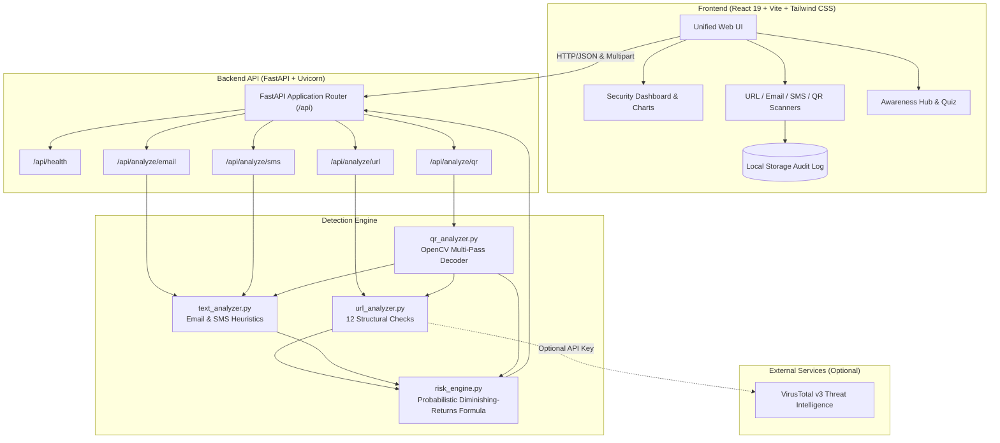

# 🛡️ PhishGuard AI — Intelligent Phishing & Scam Detection Platform

[](https://www.python.org/)
[](https://fastapi.tiangolo.com/)
[](https://react.dev/)
[](https://vitejs.dev/)
[](https://tailwindcss.com/)
[](https://opencv.org/)
[](LICENSE)
[](backend/tests/)

> **Next-generation, multi-vector cybersecurity platform designed to detect, analyze, and demystify phishing attacks across URLs, emails, SMS smishing, and QR codes (quishing) in real-time with explainable risk scoring.**

---

## 📌 Table of Contents

- [Overview](#-overview)
- [Key Features & Platform Modules](#-key-features--platform-modules)
  - [1. Unified Security Dashboard](#1-unified-security-dashboard)
  - [2. URL Reputation & Heuristic Inspector](#2-url-reputation--heuristic-inspector)
  - [3. Email Phishing & Header Analyzer](#3-email-phishing--header-analyzer)
  - [4. SMS Smishing & OTP Scam Detector](#4-sms-smishing--otp-scam-detector)
  - [5. Computer Vision QR Quishing Scanner](#5-computer-vision-qr-quishing-scanner)
  - [6. Security Awareness & Interactive Quiz](#6-security-awareness--interactive-quiz)
  - [7. Scan History & Threat Audit Log](#7-scan-history--threat-audit-log)
- [Heuristic Detection & Risk Engine Architecture](#-heuristic-detection--risk-engine-architecture)
- [System Architecture](#-system-architecture)
- [Technology Stack](#-technology-stack)
- [Project Directory Structure](#-project-directory-structure)
- [Quick Start & Installation Guide](#-quick-start--installation-guide)
  - [Prerequisites](#prerequisites)
  - [Backend Setup](#1-backend-setup-fastapi)
  - [Frontend Setup](#2-frontend-setup-react--vite)
- [API Endpoints Reference](#-api-endpoints-reference)
- [Automated Testing Suite](#-automated-testing-suite)
- [Hackathon Demo Guide & Live Test Scenarios](#-hackathon-demo-guide--live-test-scenarios)
- [Security & Responsible Disclosure](#-security--responsible-disclosure)

---

## 🌟 Overview

Modern social engineering attacks do not exist in isolation. Phishers disguise malicious domains behind shortened links, spoof corporate email headers, launch urgent SMS smishing campaigns, and print malicious QR code stickers in public venues (quishing). 

**PhishGuard AI** is an all-in-one defense platform built for cybersecurity teams, security analysts, and everyday users. It replaces opaque "black box" prediction with **transparent, explainable heuristics**:
- **Zero-Contact URL Inspection:** Extracts threat indicators from URL anatomy without ever requesting or executing malicious remote content.
- **Multi-Vector Analysis:** Correlates brand impersonation, urgency manipulation, and credential harvesting.
- **Probabilistic Risk Scoring:** Asymptotically calculates composite threat scores ($0 - 100$) using diminishing-returns probability rather than naive additive sums.
- **Actionable Remediation:** Generates tailored, defensive countermeasures for every identified threat vector.

---

## 🚀 Key Features & Platform Modules

### 1. Unified Security Dashboard
- **Threat Metric Cards:** Live visual metrics showing total scans, high-severity alerts, medium risks, and benign submissions.
- **Interactive Recharts Visualization:** Real-time risk distribution doughnut chart with dynamic tooltips and category breakdowns.
- **Quick-Scan Omnibar:** Intelligent input field that auto-detects whether the input is a web URL or an SMS text and routes it to the appropriate detection pipeline.
- **One-Click Live Demo:** Instantly loads pre-configured synthetic threat samples for rapid demonstration.

### 2. URL Reputation & Heuristic Inspector
Inspects structural and syntactic anomalies across 12 distinct attack vectors:
- **Direct IP Address Hosting:** Detects raw IPv4/IPv6 addresses used in place of domain names.
- **Userinfo `@` Spoofing:** Identifies deceptive browser authority manipulation (e.g., `http://google.com@evil-site.com`).
- **Brand Typo-Squatting & Mimicry:** Cross-references high-profile targets (PayPal, Apple, Google, Microsoft, Netflix, Chase, etc.) against lookalike domains.
- **High-Risk & Abuse TLDs:** Flags domains registered under known spam TLDs (`.top`, `.xyz`, `.buzz`, `.tk`, `.ml`, `.cf`, etc.).
- **URL Shortener Concealment:** Flags masking services (`bit.ly`, `tinyurl.com`, `t.co`, etc.) that prevent human inspection.
- **Deeply Nested Subdomains:** Detects multi-level subdomain chains engineered to simulate official corporate portals.
- **Sensitive Authentication Paths:** Identifies path endpoints targeting credentials (`/login`, `/webscr`, `/verify`, `/account`, `/wallet`).
- **Unencrypted HTTP Protocol:** Flags plaintext transport on pages requesting sensitive operations.
- **Non-Standard Ports:** Flags non-standard web ports outside `80`, `443`, or `8080`.
- **Optional Threat Intelligence Lookup:** Seamless VirusTotal v3 API fallback integration for external community threat verification.

### 3. Email Phishing & Header Analyzer
Deconstructs social engineering patterns across the Subject line, Sender address, and Email Body:
- **Sender Domain Mismatch:** Flags discrepancies where the display name or body references a brand (e.g., "PayPal Support") but the originating domain is unregistered or mismatched.
- **Public Freemail Impersonation:** Flags corporate notifications originating from free email providers (`@gmail.com`, `@yahoo.com`, `@hotmail.com`, etc.).
- **Psychological Urgency & Coercion:** Detects artificial time-pressure tactics ("Account suspended in 24 hours", "Immediate action required").
- **Credential Harvesting Solicitation:** Flags explicit demands for passwords, PINs, social security numbers, and payment cards.
- **Disguised & Dangerous Attachments:** Highlights mentions of executables (`.exe`, `.scr`, `.vbs`, `.iso`) or double-extension archives (`invoice.pdf.exe`).
- **Generic Security Salutations:** Flags unpersonalized greetings ("Dear Customer", "Valued Member") combined with security warnings.
- **Embedded URL Extraction:** Automatically parses and evaluates all hyperlinks embedded within the email text.
- **Canonical Phishing Triad:** Triggers compound threat bonuses when urgency, credential requests, and links coincide.

### 4. SMS Smishing & OTP Scam Detector
Engineered specifically for short-message threat dynamics:
- **Postal Delivery Traps:** Detects fake courier notices (USPS, FedEx, DHL) demanding credit card "redelivery fees".
- **2FA / OTP Interception:** Flags requests soliciting 6-digit codes or PINs to bypass Multi-Factor Authentication.
- **Banking Fraud Hooks:** Detects fake unauthorized charge alerts designed to induce panic callbacks.
- **Lottery & Windfall Claims:** Flags unsolicited sweepstakes, cryptocurrency payouts, and IRS tax refund lures.
- **Smishing Call-to-Action Links:** Correlates the presence of urgent alerts with embedded hyperlinks.

### 5. Computer Vision QR Quishing Scanner
Protects against physical and digital QR code attacks:
- **Multi-Pass OpenCV Decoding Pipeline:**
  1. *Pass 1:* Direct decoding of high-resolution clean matrices.
  2. *Pass 2:* Grayscale conversion and histogram normalization for low-contrast captures.
  3. *Pass 3:* Otsu's adaptive binarization for blurry, distorted, or low-light captures.
- **Quishing Risk Tagging:** Automatically accounts for inherent QR payload concealment.
- **Payload Auto-Classification:** Dispatches decoded payloads to the URL or SMS detection engine based on scheme structure.
- **Drag-and-Drop File Upload:** Supports PNG, JPEG, WebP, and BMP files with strict 10 MB guards and synthetic test presets.

### 6. Security Awareness & Interactive Quiz
- **8 In-Depth Defense Modules:**
  1. Recognizing Phishing Emails & Display-Name Spoofing
  2. SMS Smishing & Package Scam Modus Operandi
  3. Deconstructing URL Anatomy & Homoglyphs
  4. The Myth of HTTPS (Why the Padlock Icon Does Not Mean "Safe")
  5. The Golden Rule of One-Time Passcodes (OTPs)
  6. Quishing: How Physical QR Stickers Exploit Mobile Trust
  7. Emergency Incident Response: Immediate Post-Click Containment
  8. Global Incident Reporting Portals (CISA, APWG, FTC, Google Safe Browsing)
- **Interactive Knowledge Quiz:** 3 scenario-based cybersecurity questions with immediate rationale feedback and score tracking.

### 7. Scan History & Threat Audit Log
- **Zero-Database Privacy Architecture:** Stores scan audits exclusively in client-side `localStorage`.
- **Search & Multi-Facet Filtering:** Filter past audits by search term, medium (`URL`, `Email`, `SMS`, `QR`), or severity (`High`, `Medium`, `Low`).
- **One-Click JSON Export:** Download complete forensic scan reports formatted for incident tracking.
- **Local History Wipe:** One-click clear function to purge stored records on shared terminals.

---

## 🧠 Heuristic Detection & Risk Engine Architecture

PhishGuard AI does not use raw addition to sum indicator scores, preventing multiple low-risk indicators from falsely triggering critical alerts. Instead, it employs a **probabilistic diminishing-returns risk union**:

$$\text{Composite Risk Score} = \min\left(100, \left(1.0 - \prod_{i=1}^{n} \left(1.0 - \frac{w_i}{100}\right)\right) \times 100 + \text{Synergy}\right)$$

Where:
- $w_i$ is the individual weight ($1 - 100$) of each deduplicated indicator.
- Individual weights are normalized and capped at $0.95$ so no single heuristic instantly forces 100%.
- **Synergy Bonus:** If triggered indicators span 2 distinct categories, a $+4$ synergy bonus is applied; if they span 3 or more categories (e.g., Urgency + Credentials + Suspicious Domain), an $+8$ bonus is applied.
- **Critical Floor Guard:** If any single triggered indicator carries a critical weight ($\ge 45$), the composite score is locked to a minimum floor of $50$.

### Severity Tier Thresholds

| Severity Tier | Composite Score Range | Action Required | Color Code |
| :--- | :---: | :--- | :--- |
| **Low** | $0 - 29$ | Normal vigilance; no critical heuristics triggered | `Emerald (#10b981)` |
| **Medium** | $30 - 59$ | Suspicious indicators detected; verify through official channels | `Amber (#f59e0b)` |
| **High** | $60 - 100$ | Critical risk; do not navigate, reply, or enter credentials | `Rose (#f43f5e)` |

---

## 🏗️ System Architecture



---

## 💻 Technology Stack

### Frontend
- **Framework:** React 19 (`react`, `react-dom`)
- **Build Tool:** Vite 6.2 with Hot Module Replacement (HMR)
- **Styling:** Tailwind CSS v4 with custom dark cybersecurity glassmorphism theme
- **Icons:** Lucide React (`lucide-react`)
- **Data Visualization:** Recharts 3.x (`recharts`)
- **HTTP Client:** Axios with centralized error handling & base URL proxying

### Backend
- **Framework:** FastAPI 0.115+
- **ASGI Server:** Uvicorn with multi-worker support
- **Data Validation:** Pydantic v2 schemas (`schemas.py`)
- **Computer Vision:** OpenCV Headless (`opencv-python-headless`) & NumPy
- **Standard Library:** `urllib.parse`, `ipaddress`, `re`, `uuid`, `datetime`
- **Testing:** Pytest & FastAPI TestClient (`httpx`)

---

## 📁 Project Directory Structure

```text
Cyberthon/
├── .gitignore                      # Monorepo root gitignore
├── README.md                       # Comprehensive platform documentation
├── backend/
│   ├── app/
│   │   ├── __init__.py             # Application version & package metadata
│   │   ├── main.py                 # FastAPI application, CORS & endpoint routes
│   │   ├── schemas.py              # Pydantic validation models
│   │   └── detection/
│   │       ├── __init__.py         # Detection package exports
│   │       ├── risk_engine.py      # Probabilistic scoring engine & recommendation generator
│   │       ├── url_analyzer.py     # 12-point zero-contact URL heuristic engine
│   │       ├── text_analyzer.py    # Email phishing & SMS smishing heuristic analyzers
│   │       └── qr_analyzer.py      # Multi-pass OpenCV QR decoding & quishing analysis
│   ├── tests/
│   │   └── test_detection.py       # 22 automated unit and integration tests
│   ├── .env.example                # Template for environment configuration
│   ├── .gitignore                  # Python & backend specific exclusions
│   └── requirements.txt            # Python pip dependencies
└── frontend/
    ├── src/
    │   ├── components/
    │   │   ├── Header.jsx          # Top navigation bar & system status badge
    │   │   ├── Sidebar.jsx         # Responsive sidebar with navigation tabs
    │   │   ├── RiskMeter.jsx       # SVG gauge meter with animated score dials
    │   │   └── ScanResultCard.jsx  # Detailed diagnostic result card with indicators
    │   ├── pages/
    │   │   ├── Dashboard.jsx       # Analytics dashboard, quick scan & demo triggers
    │   │   ├── UrlScanner.jsx      # Dedicated URL inspection page with samples
    │   │   ├── EmailScanner.jsx    # Email phishing inspection page with samples
    │   │   ├── SmsScanner.jsx      # SMS smishing inspection page with samples
    │   │   ├── QrScanner.jsx       # QR file upload & computer vision inspection
    │   │   ├── SecurityAwareness.jsx# 8 defense topics & interactive quiz
    │   │   └── ScanHistory.jsx     # LocalStorage scan audit log with export/filter
    │   ├── services/
    │   │   └── api.js              # Centralized Axios API client & localStorage manager
    │   ├── App.jsx                 # Main layout coordinator & state orchestrator
    │   ├── main.jsx                # React root mount point
    │   └── index.css               # Design tokens, gradients, and cyber-styling
    ├── package.json                # Node.js dependencies and run scripts
    ├── vite.config.js              # Vite server & API proxy configuration
    └── .gitignore                  # Frontend & Node exclusions
```

---

## ⚙️ Quick Start & Installation Guide

### Prerequisites
- **Python:** 3.10, 3.11, or 3.12 installed
- **Node.js:** 18.x or 20.x+ with `npm` installed
- **Git:** Installed on system

---

### 1. Backend Setup (FastAPI)

1. Open a terminal and navigate to the `backend/` directory:
   ```powershell
   cd backend
   ```

2. *(Recommended)* Create and activate a Python virtual environment:
   ```powershell
   # Windows
   python -m venv venv
   .\venv\Scripts\activate

   # Linux / macOS
   python3 -m venv venv
   source venv/bin/activate
   ```

3. Install the required Python dependencies:
   ```powershell
   pip install -r requirements.txt
   ```

4. *(Optional)* Configure environment variables:
   ```powershell
   # Copy the example file
   cp .env.example .env
   ```
   *Note: If `VIRUSTOTAL_API_KEY` is omitted, the engine automatically operates in 100% offline heuristic mode.*

5. Launch the FastAPI server:
   ```powershell
   python -m uvicorn app.main:app --host 127.0.0.1 --port 8000 --reload
   ```
   The backend API will be live at: **`http://127.0.0.1:8000`**  
   Interactive Swagger API docs available at: **`http://127.0.0.1:8000/docs`**

---

### 2. Frontend Setup (React + Vite)

1. Open a separate terminal window and navigate to the `frontend/` directory:
   ```powershell
   cd frontend
   ```

2. Install the required Node packages:
   ```powershell
   npm install
   ```

3. Start the Vite development server:
   ```powershell
   npm run dev
   ```

4. Open your browser and navigate to:
   ```text
   http://127.0.0.1:5173
   ```

*The Vite development server is pre-configured with a reverse proxy route (`/api -> http://localhost:8000/api`) to eliminate CORS configuration overhead.*

---

## 📡 API Endpoints Reference

| Method | Endpoint | Description | Request Body / Param | Response Model |
| :--- | :--- | :--- | :--- | :--- |
| `GET` | `/api/health` | System health, version & reputation status | *None* | `HealthResponse` |
| `POST` | `/api/analyze/url` | Zero-contact URL heuristic inspection | `{"url": "string"}` | `ScanResponse` |
| `POST` | `/api/analyze/email` | Email subject, sender & body inspection | `{"subject": "", "sender": "", "body": ""}` | `ScanResponse` |
| `POST` | `/api/analyze/sms` | SMS text message smishing analysis | `{"message": "string"}` | `ScanResponse` |
| `POST` | `/api/analyze/qr` | Multipart image upload for QR decoding | `file: UploadFile (PNG/JPG)` | `ScanResponse` |

### Sample Response Schema (`ScanResponse`)
```json
{
  "id": "7c1264c3-e8c1-4fd2-8a90-349c4f1c1f01",
  "timestamp": "2026-10-10T14:40:00.000000Z",
  "score": 78,
  "severity": "High",
  "input_type": "url",
  "target_preview": "http://paypal-verification-center.top/webscr?cmd=_login",
  "indicators": [
    {
      "code": "BRAND_IN_HOSTNAME",
      "title": "Brand Impersonation in Hostname (Paypal)",
      "description": "The hostname references the trusted brand 'Paypal', but does not resolve to an official registered domain.",
      "weight": 35,
      "category": "impersonation"
    },
    {
      "code": "HIGH_RISK_TLD",
      "title": "High-Risk Top-Level Domain (.top)",
      "description": "The destination uses a TLD with statistically elevated rates of phishing registrations.",
      "weight": 25,
      "category": "reputation"
    },
    {
      "code": "SENSITIVE_AUTH_PATH",
      "title": "Sensitive Authentication Path in URL",
      "description": "The URL path points to sensitive account access endpoints.",
      "weight": 20,
      "category": "deception"
    }
  ],
  "recommendations": [
    "HIGH RISK: Treat this item with extreme caution. Do NOT click links or enter credentials.",
    "Verify payment requests directly through the vendor's official app or verified telephone number."
  ],
  "analysis_method": "heuristic",
  "reputation": {
    "checked": false,
    "source": null,
    "status": "not_configured",
    "details": null
  },
  "disclaimer": "This score is an estimate based on heuristic indicator analysis and does not guarantee whether the content is safe or malicious."
}
```

---

## 🧪 Automated Testing Suite

PhishGuard AI includes a 22-test automated unit and integration suite covering the risk calculation math, URL heuristics, text extraction, computer vision QR decoding, and HTTP endpoints.

To run the test suite:
```powershell
cd backend
pytest -v
```

### Test Coverage Highlights:
- `TestRiskEngine`: Boundary thresholds ($0$, $29$, $30$, $59$, $60$, $100$), indicator deduplication by code, and diminishing-returns score bounds.
- `TestURLAnalyzer`: Benign URL validation, raw IP hosts, `@` userinfo spoofing, brand mimicry combined with `.top` TLDs, and URL shorteners.
- `TestTextAnalyzer`: Benign communications, SMS postal delivery traps, SMS OTP interception, compound email phishing triads, and benign urgent workplace messages.
- `TestQRAnalyzer`: In-memory synthetic QR generation via OpenCV, automated decoding, and corrupted payload handling.
- `TestFastAPIEndpoints`: End-to-end HTTP tests validating input schemas and HTTP status codes.

---

## 🎯 Hackathon Demo Guide & Live Test Scenarios

To demonstrate PhishGuard AI during a presentation, use the following pre-configured test scenarios available directly via buttons inside the UI:

### Scenario 1: The Classic Smishing Attack (SMS Scanner)
- **Input:**
  ```text
  USPS: Your package cannot be delivered due to incomplete street address. Please pay $1.99 redelivery fee at http://usps-redelivery-portal.top to avoid return to sender.
  ```
- **Detection Highlights:**
  - `DELIVERY_FEE_SCAM` (Weight: +38) — Identifies bogus postal fee solicitations.
  - `BRAND_IN_HOSTNAME` (Weight: +35) — Detects USPS brand impersonation on an unverified domain.
  - `HIGH_RISK_TLD` (Weight: +25) — Flags the suspicious `.top` domain.
  - `SMISHING_ACTION_LINK` (Weight: +30) — Detects the coupling of postal alert + link.
  - **Result:** **High Risk ($75 - 85/100$)** with immediate recommendations to report to carrier spam numbers (`7726`).

### Scenario 2: Corporate Email Phishing (Email Scanner)
- **Subject:** `URGENT: Your PayPal Account Has Been Suspended`
- **Sender:** `security-alert@paypal-update-center.xyz`
- **Body:** `Dear Valued Customer, unauthorized activity detected. Immediate action required within 24 hours. Enter your password and SSN here: http://paypal-verification-center.top/webscr`
- **Detection Highlights:**
  - `SENDER_DOMAIN_MISMATCH` — Sender address does not match official PayPal infrastructure.
  - `URGENT_COERCION` — Flags 24-hour artificial time pressure.
  - `CREDENTIAL_HARVESTING` — Explicit solicitation of passwords and SSNs.
  - `COMPOUND_PHISHING_SIGNATURE` — Triggers the canonical phishing triad bonus.
  - **Result:** **High Risk ($80 - 95/100$)**.

### Scenario 3: Userinfo Authority Spoofing (URL Scanner)
- **URL:** `http://myaccount.google.com@evil-credential-stealer.com/auth`
- **Detection Highlights:**
  - `USERINFO_SPOOFING` (Weight: +45) — Highlights that browsers completely ignore `myaccount.google.com` before `@` and navigate directly to `evil-credential-stealer.com`.
  - **Result:** **High Risk ($65 - 75/100$)**.

### Scenario 4: Computer Vision QR Decoding (QR Scanner)
- Click the built-in **"Load Sample Phishing QR"** button on the QR Scanner page.
- Watch the OpenCV multi-pass pipeline decode the embedded matrix in milliseconds and cascade the target URL through the inspection engine.

---

## 🔒 Security & Responsible Disclosure

- **Zero Remote Execution:** PhishGuard AI never fetches, visits, renders, or downloads assets from submitted URLs. All URL analyses operate strictly on structural string anatomy, IDNA punycode transformations, and domain parsing.
- **Privacy First:** Scan records are stored exclusively in the user's browser `localStorage`. No user-submitted emails, phone numbers, or credentials are sent to external databases or third-party cloud servers.
- **Explainability Over Black Boxes:** Unlike neural models that produce uninterpretable confidence numbers, PhishGuard AI provides the exact heuristic code, readable explanation, and actionable mitigation for every trigger.

---

## 📄 License

This project is licensed under the MIT License — see the [LICENSE](LICENSE) file for details. Built for educational and defensive cybersecurity hackathons.
